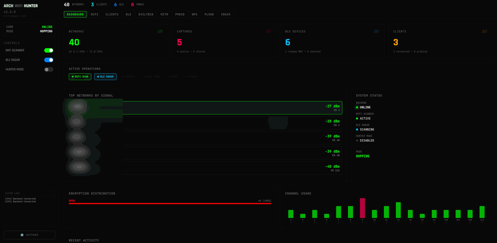
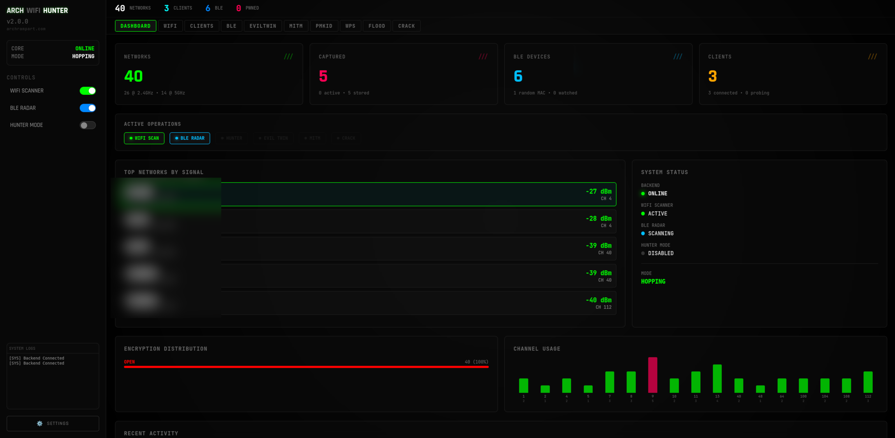
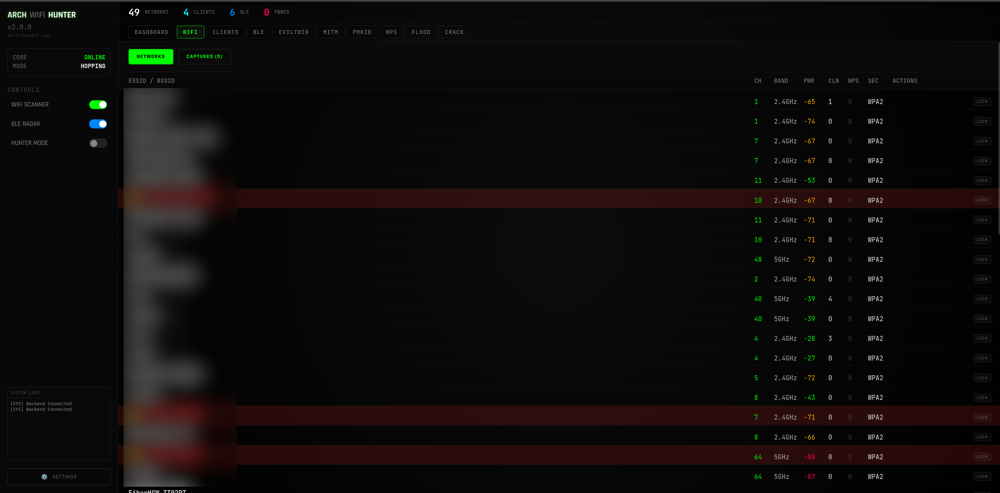
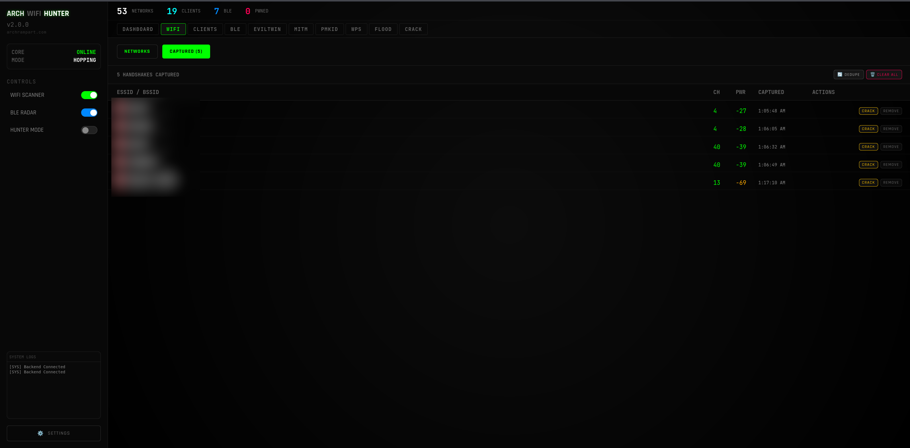
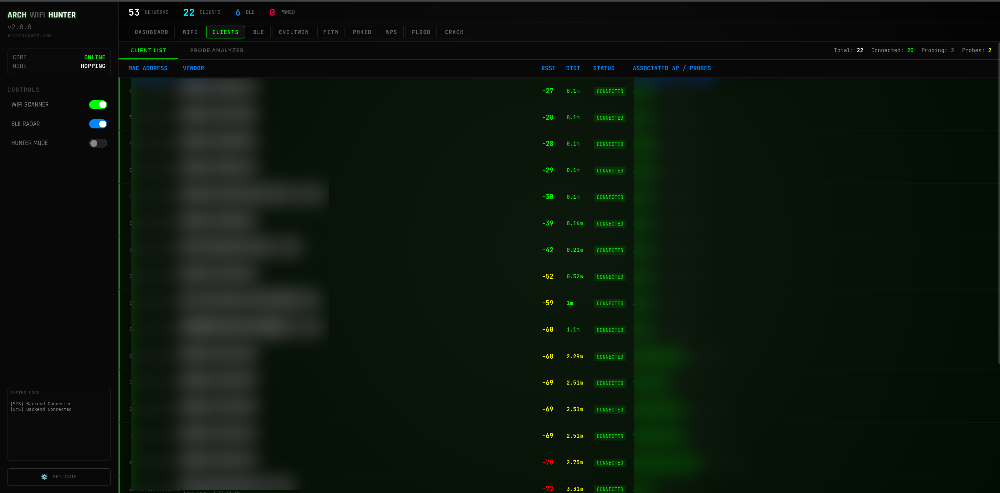
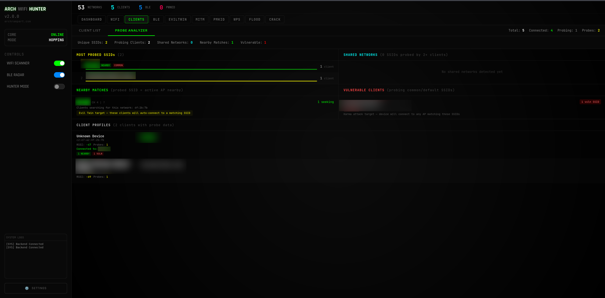
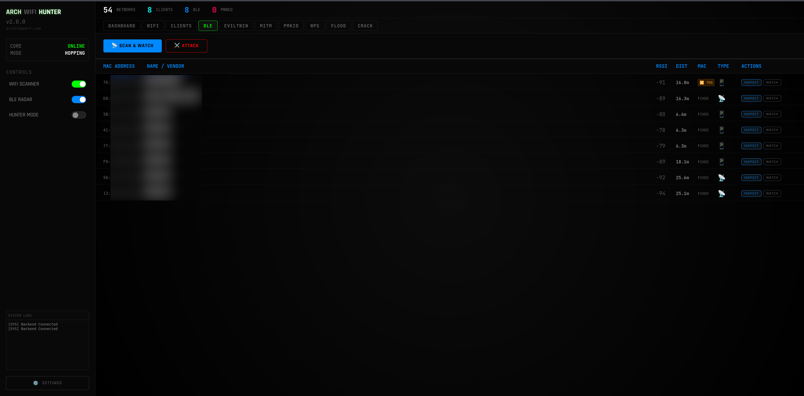

# ARCH WIFI HUNTER

**WiFi & BLE security testing and intelligence platform — built for Kali Linux.**


A single-pane web console for 802.11 and Bluetooth Low Energy assessments: scanning, handshake/PMKID capture and cracking, rogue AP (Evil Twin) with MITM, WPS, beacon flooding, client probe intelligence, and a 7-attack BLE suite — all driven from one browser UI.

[archrampart.com](https://www.archrampart.com)

> ⚠️ **Authorized use only.** This project is intended for penetration testing with **explicit written permission**, security research, and CTF/lab environments. Attacking networks or devices you do not own or are not authorized to test is illegal. You are responsible for how you use it.



---

## Features

| Module | Description |
|--------|-------------|
| **WIFI** | Dual-band scanning, deauth, handshake capture, live client monitoring |
| **BLE** | Device discovery, distance estimation, GATT inspection, 7-attack suite |
| **EVIL TWIN** | Rogue AP — Captive Portal (credential harvest) or Internet Relay (NAT + MITM) |
| **MITM** | scapy packet sniffer, credential capture, DNS spoofing, PCAP export |
| **PROBE ANALYZER** | Client intelligence — SSID profiling, shared networks, nearby match, vulnerable-client detection |
| **PMKID** | Clientless PMKID hash capture via hcxdumptool |
| **WPS** | Pixie Dust & PIN attacks via reaver / pixiewps |
| **FLOOD** | Beacon flood via mdk4 |
| **CRACK** | Unified password cracking (handshake + PMKID) via aircrack-ng |
| **HUNTER MODE** | Automated target selection, handshake capture, and rotation |

### Evil Twin Modes

| Mode | Description |
|------|-------------|
| **Captive Portal** | Fake login page (WiFi Login / Router Update) for credential harvesting. Redirects all client traffic to the portal. |
| **Internet Relay** | Clients get real internet via NAT masquerade while host connectivity is preserved — enables live MITM packet capture. Custom SSID or clone a target network. |

### MITM Suite

| Feature | Description |
|---------|-------------|
| **Packet Sniffer** | Real-time DNS query, HTTP request, and credential capture via scapy |
| **Credential Detection** | Automatic POST-body inspection for passwords, tokens, and auth data |
| **DNS Spoofing** | Live dnsmasq config injection with domain-to-IP mapping |
| **PCAP Export** | Download captured packets as `.pcap` for Wireshark analysis |

### Probe Analyzer

| Panel | Description |
|-------|-------------|
| **Most Probed SSIDs** | Ranked list of SSIDs most searched by nearby clients |
| **Shared Networks** | SSIDs probed by 2+ clients — devices from the same place/organization |
| **Nearby Matches** | Probed SSIDs that match real active APs — ideal Evil Twin targets |
| **Vulnerable Clients** | Devices probing common/default SSIDs — Karma-attack candidates |
| **Client Profiles** | Per-device probe summary with color-coded SSIDs, RSSI, connection status |

### BLE Attack Suite

| Attack | Description |
|--------|-------------|
| **Auto-Connect** | Service enumeration, vulnerability detection, writable-characteristic probing |
| **PIN Brute-Force** | 3-phase analysis: pairing-type detection, characteristic probing, PIN dictionary |
| **Fuzzing** | Payload fuzzing with crash detection and auto-reconnect |
| **Command Injection** | Injection payloads, notify subscription, response pattern matching |
| **Hijacking** | Continuous connection monitoring with live notification tracking |
| **Battery Drain** | Multi-phase drain (rapid connect/disconnect, GATT flood, max-MTU request) |
| **Beacon Spoof** | HCI-level beacon transmission: iBeacon, Eddystone-URL, Name Clone, BLE Flood |

---

## Screenshots

| | |
|---|---|
|  |  |
|  |  |
|  |  |

---

## Requirements

- **Kali Linux** (or Debian-based with the tools below)
- **Python 3.10+**
- **Node.js 18+**
- **WiFi adapter** with monitor **and** AP mode + injection (e.g. MT7612U / Alfa AWUS036ACH / ACM)
- **Bluetooth adapter** (internal or USB) for the BLE suite
- **Root privileges**

### Dual-interface setup (recommended)

Evil Twin's **Internet Relay** mode and simultaneous management need two interfaces:

| Interface | Role |
|-----------|------|
| `wlan0` (or `eth0`) | Host uplink / management (kept online) |
| `wlan1` | Rogue AP (hostapd) + monitor/injection |

The backend auto-detects which interface carries the default route and uses the other for attacks.

---

## Install

```bash
sudo ./setup.sh
```

This checks/installs the system tools, creates the Python virtualenv, installs dependencies, and builds the frontend.

<details>
<summary>Manual install</summary>

```bash
sudo apt update
sudo apt install -y aircrack-ng mdk4 hcxdumptool hcxtools reaver pixiewps \
                    nmap hostapd dnsmasq iptables python3-venv python3-pip nodejs npm

python3 -m venv backend/venv
backend/venv/bin/pip install --upgrade pip
backend/venv/bin/pip install -r requirements.txt

cd frontend && npm install && npm run build && cd ..
mkdir -p backend/captures backend/exports wordlists
```
</details>

---

## Usage

```bash
sudo ./start.sh
```

The frontend is served by the backend on a **single port**, so the whole console is reachable from any device on the LAN:

```
http://<host-ip>:8777        # UI + API
http://<host-ip>:8777/docs   # OpenAPI docs
```

Open it on the host, or from your phone/laptop on the same network — no separate dev server needed.

<details>
<summary>Manual start</summary>

```bash
# BLE pairing agent (optional, needed for BLE pairing/inspection)
sudo backend/venv/bin/python backend/ble_agent.py &

# Backend + built UI on one port
sudo backend/venv/bin/uvicorn backend.main:app --host 0.0.0.0 --port 8777
```
</details>

---

## Architecture

```
backend/   FastAPI + WebSocket server; serves the built UI and the REST/WS API
  sniffer / attacks / eviltwin / mitm / pmkid / wps_attack / beacon_flood / hunter
  unified_cracker / ble_scanner / ble_attack / ble_agent / platform_wifi
frontend/  React 19 + Vite single-page console (built and served by the backend)
```

- **Stack:** FastAPI · WebSocket (0.5 s live updates) · scapy · bleak · React 19 · Vite
- **Interfaces:** subprocess orchestration of aircrack-ng, hostapd, dnsmasq, mdk4, hcxdumptool, reaver
- **UI ↔ API:** same-origin REST + a `/ws` stream for live scan/attack state

### System tools

| Tool | Package | Used by |
|------|---------|---------|
| aircrack-ng | `aircrack-ng` | WiFi, Crack, Hunter |
| mdk4 | `mdk4` | Beacon Flood |
| hcxdumptool / hcxpcapngtool | `hcxdumptool`, `hcxtools` | PMKID |
| reaver / pixiewps | `reaver`, `pixiewps` | WPS |
| hostapd / dnsmasq / iptables | `hostapd`, `dnsmasq`, `iptables` | Evil Twin |
| scapy / bleak | pip | MITM / BLE |

---

## Legal

This software is provided for **authorized security testing, research, and education only**. Use it exclusively on networks and devices you own or have **explicit written permission** to assess. The authors assume no liability for misuse or damage. Unauthorized access to computer systems and networks is a crime in most jurisdictions.

## License

[MIT](LICENSE)
